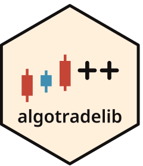

# pyatl 

<!-- badges: start -->
[](https://github.com/algotradelib/pyatl/actions/workflows/conda-check.yaml?query=branch%3Amain)
[](https://github.com/algotradelib/pyatl/actions/workflows/pip-check.yaml?query=branch%3Amain)
[](https://github.com/algotradelib/pyatl/actions/workflows/wheel-check.yaml?query=branch%3Amain)
[](https://codecov.io/gh/algotradelib/pyatl)
[](https://github.com/algotradelib/pyatl/blob/main/pyproject.toml)
<!-- badges: end -->

Python strategies on [algotradelib](https://github.com/algotradelib/algotradelib)'s C++ backtest.
You write the strategy in Python; the replay, the fills and the costs run in C++.

```python
import pandas as pd
import pyatl

class Hold:
    def on_bar(self, ctx, bar):
        ctx.target(bar.symbol, 10)  # hold 10 shares, bought at the next bar's open

frame = pd.read_csv("bars.csv", parse_dates=["time"])
result = pyatl.backtest(Hold(), {"005930": frame}, commission=0.00015, sell_tax=0.002)
print(result.closing_equity, result.total_return, result.max_drawdown)
```

Documentation: <https://algotradelib.github.io/python/>.

## Install

pyatl needs Python 3.12 or newer and an installed algotradelib; see [its install guide](https://github.com/algotradelib/algotradelib#install).
Then:

```sh
pip install git+https://github.com/algotradelib/pyatl.git
```

If algotradelib is installed under a prefix CMake does not search, set `CMAKE_PREFIX_PATH` to that prefix.
`pyatl.algotradelib_version` tells which library version a build was made against.
NumPy is its only Python dependency; the examples read data with pandas, installed separately (`pip install pandas`).

## Writing a strategy

A strategy is any object with these methods; it needs no base class.

| Method | Called |
| --- | --- |
| `on_bar(ctx, bar)` | for each bar, in time order |
| `on_bars(ctx, bars)` | once per period, with every symbol's bar for it (instead of `on_bar`) |
| `on_stop(ctx)` | after the last bar (optional) |

Set the strategy up in `__init__`: `on_start` is not supported.

- `bar`: `symbol`, `time` (the period end, ns since the epoch, UTC), `open`, `high`, `low`, `close`, `volume`.
- `ctx`: `now`, `target(symbol, quantity)`, `position(symbol)`, `cash()`.

Both are valid only during the call; keep the numbers, not the objects.

`backtest()` takes a dict of symbol to bars: a pandas or polars DataFrame, or a dict of arrays.
The time is a `time` column or a pandas `DatetimeIndex`, as datetime64; integer times are refused.
[`examples/sma_crossover.py`](examples/sma_crossover.py) is a complete strategy.

## Feeding a replay yourself

`backtest()` replays the bars you give it in time order.
When the sequence is yours to define (rolling windows, a resampled path, bars generated as the run goes), feed a `Replay` in as many steps as you like, then finish it once:

```python
replay = pyatl.Replay(Hold(), ["005930"], commission=0.00015)
for part in parts:  # each a {symbol: bars} dict, as backtest() takes
    replay.feed(part)
result = replay.finish()
```

For a sequence you build as one long table, `feed_bars(symbol, time, open=..., high=..., low=..., close=..., volume=...)` replays its rows in the order given.
Each feed is checked before any of it runs: a symbol's bars must move forward in time, and no bar may end before the bar fed before it.
The bars still run through the C++ engine one at a time; in our measurements, feeding in blocks took no longer than one `backtest()` call over the same bars.

## The result

`BacktestResult` holds the fills (with commission, sale tax and slippage), the equity curve, the library's summary (total return, Sharpe, Sortino, maximum drawdown, turnover, costs paid), and what did not go as asked: refused orders with the library's reason, orders left unfilled, gaps, bars whose equity could not be valued, and the lowest cash if it went below zero.
The fills and the equity curve are columns (NumPy arrays, and lists for the symbol and side), so any other measure is a few lines of NumPy or pandas away.

## Status

Early.
It backtests Korean (KRX) stocks with target positions in whole shares.
Other markets, limit orders and live trading are not supported yet.

## Acknowledgements

This project was developed with the assistance of generative AI tools.

## Disclaimer

pyatl is released under the MIT license; see [LICENSE](LICENSE).
The software is provided as is, without warranty of any kind, and the authors are not liable for any loss, including trading losses, arising from its use.
Nothing in this repository is investment advice.
